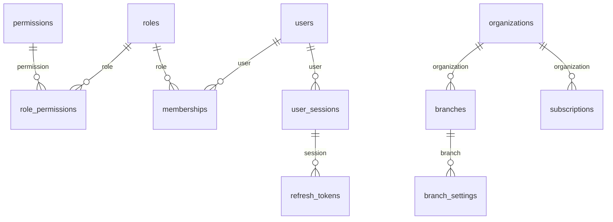

# Relationships

Foreign keys inside each database (from the Prisma `@relation` attributes), and the links between databases.

## Identity (`sombill_identity`)

| From               | Column(s)        | To              | On delete |
| ------------------ | ---------------- | --------------- | --------- |
| `role_permissions` | `roleId`         | `roles`         | Cascade   |
| `role_permissions` | `permissionCode` | `permissions`   | Cascade   |
| `memberships`      | `userId`         | `users`         | Cascade   |
| `memberships`      | `roleId`         | `roles`         | Restrict  |
| `user_sessions`    | `userId`         | `users`         | Cascade   |
| `refresh_tokens`   | `sessionId`      | `user_sessions` | Cascade   |

## Organization (`sombill_organization`)

| From              | Column(s)        | To              | On delete |
| ----------------- | ---------------- | --------------- | --------- |
| `branches`        | `organizationId` | `organizations` | Restrict  |
| `branch_settings` | `branchId`       | `branches`      | Cascade   |
| `subscriptions`   | `organizationId` | `organizations` | Restrict  |

## Between databases (kept in sync by events, no SQL foreign key)

| Identity column                                      | Refers to                               | Kept in sync by                                                       |
| ---------------------------------------------------- | --------------------------------------- | --------------------------------------------------------------------- |
| `memberships.organization_id`                        | `sombill_organization.organizations.id` | `organization.created` → owner membership                             |
| `memberships.branch_id`                              | `sombill_organization.branches.id`      | `branch.created` → `known_branches` row used to validate branch roles |
| `known_branches.id`                                  | `sombill_organization.branches.id`      | `branch.created`                                                      |
| `organizations.created_by_user_id` (organization DB) | `sombill_identity.users.id`             | set from the verified access token                                    |

